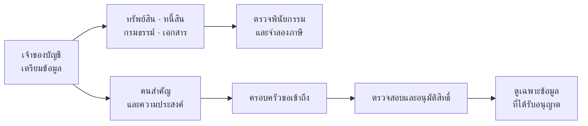
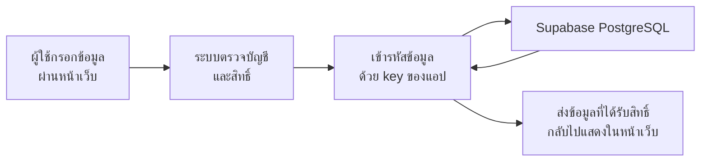

# ภาพรวมระบบอยู่ต่อ (YooTor)

เอกสารนี้อธิบายระบบตามโค้ดปัจจุบัน เพื่อให้ทีมและผู้ทดลองใช้งานเข้าใจว่าแต่ละหน้าทำอะไร ข้อมูลเชื่อมกันอย่างไร และต้องเตรียมอะไรเพิ่มเติมก่อนนำไปใช้งานจริง

## 1. YooTor คืออะไร

อยู่ต่อเป็นพื้นที่สำหรับ **เตรียมและจัดระเบียบข้อมูลสำคัญของตัวเองและครอบครัว** เช่น ทรัพย์สิน หนี้สิน กรมธรรม์ เอกสาร บุคคลที่ไว้ใจ และความประสงค์ เพื่อให้ค้นหาและดำเนินการต่อได้ง่ายขึ้น

ระบบมีแนวคิดให้ครอบครัวส่งคำขอเข้าถึงข้อมูลตามสิทธิ์ที่เจ้าของกำหนด แต่ปัจจุบันส่วนการเข้าถึงของครอบครัวจริงยังไม่พร้อมเปิดใช้งานใน production

> **สถานะปัจจุบัน:** เป็น MVP สำหรับทดลองและพัฒนาต่อ ยังไม่ควรถือว่าพร้อมรับข้อมูลลูกค้าจริงหรือผ่านการรับรองด้านกฎหมายและ PDPA

## 2. ใครใช้ระบบ

| ผู้ใช้ | เป้าหมาย | สถานะปัจจุบัน |
| --- | --- | --- |
| เจ้าของบัญชี | เตรียมข้อมูลสำคัญไว้ล่วงหน้า | บันทึกทรัพย์สิน เอกสาร บุคคล ความประสงค์ และตรวจทานข้อมูลได้ |
| ครอบครัว | เรียนรู้สิ่งที่ต้องทำและดูข้อมูลที่ได้รับอนุญาต | ทดลองการขอสิทธิ์และเช็กลิสต์ได้ แต่บัญชีครอบครัวจริงยังถูกปิดใน production |
| ผู้ดูแลระบบหรือผู้ตรวจสอบ | ตรวจหลักฐานและสิทธิ์ของครอบครัว | ยังไม่มีระบบปฏิบัติงานจริงสำหรับเจ้าหน้าที่ |

## 3. ตัวอย่างการใช้งานตั้งแต่ต้นจนจบ

สมมติคุณสมชายต้องการเตรียมข้อมูลให้ลูกสาว:

1. สมชายสมัครบัญชีและเข้าสู่ระบบ
2. เพิ่มลูกสาวในหน้าคนสำคัญ แล้วระบุหมวดข้อมูลที่ตั้งใจอนุญาตให้เข้าถึง
3. เพิ่มบ้าน บัญชีธนาคาร กรมธรรม์ และหนี้สินในหน้าทรัพย์สิน
4. อัปโหลดเอกสารที่เกี่ยวข้อง เช่น สำเนาโฉนดหรือกรมธรรม์ แล้วเชื่อมเอกสารกับรายการที่เกี่ยวข้อง
5. หากมีพินัยกรรมอยู่แล้ว เลือกเอกสารและตอบคำถามตรวจทานเบื้องต้น
6. บันทึกข้อความเพิ่มเติม เช่น เอกสารต้นฉบับอยู่ที่ไหน หรือควรติดต่อใครก่อน
7. ในโหมดทดลอง เปลี่ยนเป็นมุมมองครอบครัว ส่งคำขอ แล้วกลับมาที่เจ้าของเพื่อตรวจและอนุมัติหมวดข้อมูล

ขั้นตอนขอสิทธิ์ในข้อ 7 เป็นการจำลอง ยังไม่มีการตรวจการเสียชีวิตอัตโนมัติ และยังไม่มีกระบวนการจริงที่ให้เจ้าหน้าที่ตรวจหลักฐานและเปิดข้อมูลในกรณีเจ้าของไม่สามารถอนุมัติเองได้

## 4. แต่ละหน้าทำอะไร

### 4.1 หน้าแรก — `/`

หน้าแนะนำบริการสำหรับผู้ที่ยังไม่ได้เข้าสู่ระบบ มีปุ่มสมัครสมาชิกและทดลองใช้งาน

**Use case:** ผู้ใช้ใหม่ต้องการดูว่าระบบทำอะไรได้บ้างก่อนสร้างบัญชี

### 4.2 สมัครสมาชิกและเข้าสู่ระบบ — `/register`, `/login`

ใช้สร้างบัญชีและกลับเข้ามาใช้งาน เจ้าของสมัครด้วยอีเมลและรหัสผ่าน พร้อมยอมรับการใช้ข้อมูล

**Use case:** เจ้าของสร้างบัญชีเพื่อเก็บข้อมูลเตรียมไว้และกลับมาแก้ไขภายหลัง

มีโหมดทดลองสำหรับสำรวจระบบด้วยข้อมูลสมมติ โดยพื้นที่ทดลองมีอายุจำกัด 24 ชั่วโมง ปัจจุบันยังไม่มีการส่งอีเมลยืนยัน ระบบลืมรหัสผ่าน หรือระบบกู้บัญชี

### 4.3 ภาพรวม — `/app`

Dashboard แสดงคะแนนความพร้อม ทรัพย์สิน เอกสาร คนสำคัญ งานที่ควรทำต่อ และกิจกรรมล่าสุด

**Use case:** เจ้าของเข้ามาดูว่ายังไม่ได้เพิ่มบุคคลที่ไว้ใจหรือเอกสาร แล้วกดเข้าไปดำเนินการต่อ

คะแนนวัดความครบของข้อมูลตามเกณฑ์ภายในแอป ไม่ใช่การประเมินว่าพินัยกรรมหรือการจัดการมรดกถูกต้องตามกฎหมาย

### 4.4 ทรัพย์สินของฉัน — `/app/assets`

ทะเบียนสำหรับเพิ่ม แก้ไข ค้นหา และลบข้อมูลทรัพย์สิน เช่น อสังหาริมทรัพย์ บัญชีธนาคาร การลงทุน รถ และกรมธรรม์

ข้อมูลที่บันทึกเพิ่มเติมได้ ได้แก่:

- มูลค่าโดยประมาณและวันที่ประเมิน
- ลักษณะการถือครองและสัดส่วนของเจ้าของ
- ภาระหนี้ที่เกี่ยวข้อง
- ผู้รับที่ตั้งใจไว้และสัดส่วนที่ต้องการบันทึก
- เอกสารจากคลังเอกสารที่เกี่ยวข้อง

**Use case:** สมชายเพิ่มบ้าน ระบุว่าถือครอง 50% แล้วเชื่อมสำเนาโฉนดกับรายการบ้าน

ข้อมูลผู้รับและสัดส่วนเป็นบันทึกเพื่อวางแผน การบันทึกในแอปไม่ได้โอนทรัพย์สินหรือยืนยันสิทธิรับมรดกโดยอัตโนมัติ

#### หนี้สินและภาระคงค้าง

ในหน้าทรัพย์สินมีทะเบียนหนี้สินแยก สามารถเพิ่ม แก้ไข ลบ ระบุเจ้าหนี้ ยอดคงเหลือ วันที่ และทรัพย์สินที่เกี่ยวข้องได้

การบันทึกหนี้ไม่ได้ยืนยันว่าหนี้นั้นหักภาษีได้ หากบันทึกหนี้เดียวกันทั้งในรายการทรัพย์สินและทะเบียนหนี้ ต้องระวังไม่นับซ้ำ

#### กรมธรรม์ประกัน

ส่วนเพิ่มกรมธรรม์อยู่ในหน้าทรัพย์สิน สามารถบันทึกบริษัท ประเภท สถานะ วันคุ้มครอง ผู้เอาประกัน ผู้รับประโยชน์หลายคนและสัดส่วน รวมถึงข้อมูลติดต่อ เลขกรมธรรม์ในหน้ารายการจะแสดงแบบปิดบางส่วน

**Use case:** สมชายเก็บข้อมูลว่ามีประกันชีวิตกับบริษัทใด ใครเป็นผู้รับประโยชน์ และเอกสารอยู่ที่ไหน

ระบบยังไม่สรุปอัตโนมัติว่าเงินประกันส่วนใดเป็นมรดกหรือคิดภาษีอย่างไร และกรมธรรม์เก่าที่บันทึกเป็นข้อความยังไม่ได้แปลงเป็นข้อมูลแบบใหม่อัตโนมัติ

### 4.5 คนสำคัญของฉัน — `/app/contacts`

ใช้เก็บรายชื่อบุคคลที่เกี่ยวข้อง เช่น คนที่ไว้ใจ ผู้รับประโยชน์ที่ตั้งใจไว้ หรือผู้ที่อยากให้ช่วยจัดการ พร้อมข้อมูลติดต่อและหมวดข้อมูลที่ตั้งใจอนุญาต

**Use case:** เพิ่มลูกสาว ระบุความสัมพันธ์และข้อมูลติดต่อ แล้วเลือกว่าต้องการอนุญาตให้ดูทรัพย์สินหรือเอกสาร

การเพิ่มชื่อหรือเลือกสิทธิ์ไม่ได้เปิดข้อมูลให้ทันที ยังต้องผ่านคำขอและการอนุมัติ การระบุชื่อในแอปไม่ได้ยืนยันสิทธิทางกฎหมายของบุคคลนั้น

### 4.6 คลังเอกสาร — `/app/documents`

ใช้เก็บและค้นหาไฟล์สำคัญ:

- อัปโหลด PDF, PNG และ JPEG
- ตั้งชื่อและหมวดหมู่
- ดูตัวอย่าง ดาวน์โหลด และลบไฟล์
- เลือกเอกสารไปเชื่อมกับทรัพย์สินหรือการตรวจพินัยกรรม

**Use case:** อัปโหลดสำเนาโฉนด แล้วเชื่อมไฟล์เข้ากับรายการบ้าน

ปัจจุบันมีข้อจำกัดขนาดและการตรวจประเภทไฟล์เบื้องต้น แต่ยังไม่มีระบบสแกนมัลแวร์ ไฟล์เก็บในฐานข้อมูลแบบเข้ารหัส ยังไม่ได้แยกไป private object storage

### 4.7 พินัยกรรมและความประสงค์ — `/app/instructions`

หน้านี้แยกเป็นสองงานหลัก:

#### ตรวจพินัยกรรมที่มีอยู่

เหมาะเมื่อผู้ใช้มีเอกสารแล้วและต้องการดูว่ามีข้อมูลใดควรตรวจเพิ่มเติม:

1. เลือกเอกสารจากคลัง หรือกลับไปอัปโหลดก่อน
2. เลือกประเภทพินัยกรรม
3. ตอบคำถามเกี่ยวกับข้อมูลผู้ทำ วันที่ การลงนาม พยาน และการแก้ไข
4. เลือกบุคคลหรือทรัพย์สินที่เกี่ยวข้อง
5. บันทึกและดูผลตรวจ

ระบบแสดงข้อมูลที่ยังขาดและประเด็นที่ควรตรวจเพิ่มเติม และเก็บผลตรวจแยกได้หลายชุด

**ข้อจำกัด:** ระบบยังไม่ได้อ่านไฟล์พินัยกรรมด้วย AI ผลตรวจอิงคำตอบของผู้ใช้และกฎเบื้องต้น ตรวจตาม baseline ยังไม่ครบ และไม่รับรองความถูกต้อง ความแท้ หรือผลทางกฎหมายของเอกสาร

#### บันทึกความประสงค์

ใช้ฝากข้อความทั่วไป เช่น “เอกสารต้นฉบับอยู่ที่ไหน” หรือ “อยากให้ครอบครัวติดต่อใครก่อน”

ฉบับร่างพินัยกรรมที่เคยสร้างไว้ยังอยู่ในรายการเดิม แต่แยกจากเส้นทางตรวจพินัยกรรมหลัก

### 4.8 ภาษีเจ้ามรดก — `/app/tax`

ใช้เตรียมข้อมูลและทดลองทำความเข้าใจวิธีคิด ไม่ใช่ระบบยื่นภาษี มีสองส่วน:

1. **เช็กลิสต์เตรียมข้อมูลภาษี:** เลือกสถานการณ์และติดตามรายการที่ทำแล้ว
2. **ตัวจำลองภาษีการรับมรดกแบบจำกัด:** ผู้ใช้ยืนยันและกรอกตัวเลขเอง สำหรับตัวอย่างผู้รับหนึ่งคนจากเจ้ามรดกหนึ่งราย ภายใต้สมมติฐานที่หน้าจอระบุ

**Use case:** ทดลองดูวิธีคิดส่วนเกินและอัตราที่เลือกจากตัวเลขสมมติที่ได้ตรวจสอบแล้ว

ข้อจำกัด:

- ระบบไม่ได้ตัดสินว่าทรัพย์สินใดเข้าเกณฑ์หรือหนี้ใดหักได้
- ยังไม่คำนวณภาษีเงินได้ของผู้เสียชีวิตหรือกองมรดก
- ยังไม่ยื่นแบบหรือยืนยันว่าบุคคลนั้นต้องเสียภาษีจริง
- ผลจำลองไม่ถูกบันทึก ส่วนความคืบหน้าของเช็กลิสต์เก็บใน browser ของเครื่องนั้น
- ควรตรวจข้อมูลและหลักเกณฑ์กับกรมสรรพากรหรือผู้เชี่ยวชาญก่อนดำเนินการจริง

### 4.9 พื้นที่สำหรับครอบครัว — `/app/family`

ใช้จำลองการขอเข้าถึงและตรวจคำขอตามบทบาท:

1. เปลี่ยนจากมุมมองเจ้าของเป็นครอบครัวในโหมดทดลอง
2. ครอบครัวส่งคำขอเข้าถึง
3. เจ้าของกลับมาตรวจและเลือกหมวดข้อมูลที่อนุมัติ
4. ครอบครัวเห็นเฉพาะข้อมูลที่ผ่านเงื่อนไขสิทธิ์

**Use case:** สมชายอนุมัติให้ลูกสาวดูรายการทรัพย์สิน แต่ยังไม่อนุมัติให้ดูเอกสาร

ขั้นตอนนี้ยังเป็น flow ทดลอง ไม่ได้ตรวจตัวตน ตรวจใบมรณบัตร หรือพิสูจน์สิทธิจริง บัญชีครอบครัวจริงถูกปิดใน production

### 4.10 รายการดำเนินการ — `/app/checklist`

เช็กลิสต์สำหรับติดตามงานที่อาจต้องทำ พร้อมสถานะ หมายเหตุ และข้อมูลประกอบ

**Use case:** ครอบครัวบันทึกว่าติดต่อบริษัทประกันแล้ว แต่กำลังรอเอกสารเพิ่มเติม

ความคืบหน้าของครอบครัวแยกจากเจ้าของ และใช้ได้แม้ยังไม่ได้รับสิทธิ์ดูทรัพย์สินหรือเอกสารส่วนตัว

### 4.11 ผู้ช่วย AI — `/app/assistant`

ใช้ถามแนวทางทั่วไป เช่น ควรเตรียมเอกสารอะไรเพื่อติดต่อธนาคาร หรือเริ่มจัดการเรื่องประกันอย่างไร

ขณะจัดทำเอกสารนี้ยังไม่ได้ตั้งค่า AI provider ระบบจึงใช้คำตอบจากชุดแนวทางที่เตรียมไว้ ไม่ได้ให้โมเดลอ่านข้อมูลทั้งหมดของผู้ใช้

มีจุดเชื่อมต่อ AI ภายนอกเตรียมไว้ แต่ต้องตั้งค่า ทดสอบ และทบทวนการใช้ข้อมูลส่วนบุคคลก่อนใช้งานจริง ประวัติสนทนายังไม่เก็บถาวร

### 4.12 ตั้งค่าและความเป็นส่วนตัว — `/app/settings`

ใช้แก้ชื่อและเบอร์โทร ดูกิจกรรมล่าสุด ส่งออกข้อมูล JSON และลบบัญชี

- Export มีข้อมูลและ metadata แต่ไม่มีไฟล์เอกสารแนบ ต้องดาวน์โหลดไฟล์แยก
- ยังแก้อีเมลบัญชีหรือจัดการ session ของอุปกรณ์อื่นจากหน้านี้ไม่ได้
- ยังไม่มีระบบกู้รหัสผ่าน

## 5. ข้อมูลถูกจัดเก็บและส่งกลับอย่างไร

โครงสร้างหลัก:

- **Frontend และ API:** Next.js, React และ TypeScript
- **Database:** PostgreSQL ผ่าน Prisma; เครื่องพัฒนาปัจจุบันตั้งค่าให้เชื่อม Supabase
- **Encryption:** ข้อมูลส่วนตัวหลายส่วนถูกเข้ารหัสก่อนบันทึก แอปต้องใช้ encryption key เดิมเพื่อถอดรหัส
- **สิทธิ์:** server ตรวจบัญชีและสิทธิ์ก่อนส่งข้อมูล ผู้ใช้ครอบครัวเห็นได้ตามเงื่อนไขที่ได้รับอนุมัติ
- **AI:** มีจุดเชื่อม gateway แบบเลือกใช้ แต่ยังไม่ได้ตั้งค่าในเครื่องพัฒนาปัจจุบัน

การเปิดตารางใน Supabase อาจเห็นรายละเอียดเป็น `ciphertext` แทนข้อความที่อ่านได้ ส่วน `.env` และ encryption key ต้องเก็บเป็นความลับและไม่ commit ขึ้น Git

หากไม่ได้ตั้ง `DATABASE_URL` ใน development ระบบจะใช้ไฟล์ local ที่เข้ารหัสแทน ส่วน production บังคับให้ใช้ PostgreSQL และตั้ง encryption key

## 6. สถานะปัจจุบันเทียบกับ production

การ build หรือ deploy ได้ไม่ได้หมายความว่าพร้อมเปิดบริการจริง ตารางนี้แสดงสถานะและงานที่ยังต้องทำ:

| เรื่อง | ตอนนี้ | ก่อนใช้จริง |
| --- | --- | --- |
| บัญชีเจ้าของ | สมัครและเก็บข้อมูลได้ | ยืนยันอีเมล ลืมรหัสผ่าน กู้บัญชี และจัดการ session |
| บัญชีครอบครัว | ทดลองขอและอนุมัติสิทธิ์ได้ | ยืนยันตัวตน ตรวจหลักฐาน อำนาจและสิทธิ์; บัญชีจริงยังถูกปิดใน production |
| การเสียชีวิต | ไม่มี trigger อัตโนมัติ | ออกแบบกระบวนการตรวจและผู้อนุมัติ; ประเมินการเชื่อมภายนอกตามสิทธิ์ที่ได้รับ |
| ตรวจพินัยกรรม | ตรวจจากคำตอบบางส่วน | ให้ผู้เชี่ยวชาญตรวจเกณฑ์ เพิ่มข้อมูลตาม baseline และประเมินการอ่านไฟล์ |
| ภาษี | จำลองกรณีจำกัดจากตัวเลขที่ผู้ใช้ยืนยัน | ตรวจสูตรและข้อยกเว้นกับผู้เชี่ยวชาญ เพิ่มกรณีที่จำเป็นและทดสอบผล |
| เอกสาร | เก็บเข้ารหัสและตรวจไฟล์เบื้องต้น | private object storage, สแกนมัลแวร์ และนโยบายจัดการไฟล์ |
| ฐานข้อมูล | อ่านเขียนข้อมูล MVP ผ่าน transaction lock ร่วมกัน | เปลี่ยนเป็น query แยกตาม household และทดสอบการรองรับหลายผู้ใช้ |
| Backup และ key | ต้องจัดการเอง | สำรองฐานข้อมูลและ encryption key พร้อมทดลองกู้คืน |
| Privacy / PDPA | มีการเก็บความยินยอมพื้นฐาน | ทบทวนฐานการใช้ข้อมูล ระยะเก็บ การลบ สิทธิผู้ใช้ และกระบวนการตอบเหตุการณ์ |
| ผู้ช่วย AI | คำตอบที่เตรียมไว้; gateway ยังไม่ตั้งค่า | เลือก provider ตรวจการส่งข้อมูล ทดสอบคุณภาพ และให้ผู้ใช้ยืนยันขอบเขตข้อมูล |

## 7. ลำดับทดลองใช้งานที่แนะนำ

ใช้ข้อมูลสมมติก่อน แล้วลองตามลำดับนี้:

1. กด **ทดลองใช้งานระบบ** ที่หน้าแรก
2. ไปที่ **คนสำคัญของฉัน** และเพิ่มบุคคลตัวอย่าง
3. ไปที่ **ทรัพย์สินของฉัน** และเพิ่มทรัพย์สิน กรมธรรม์ หรือหนี้สินตัวอย่าง
4. ไปที่ **คลังเอกสาร** และอัปโหลดไฟล์ตัวอย่างที่ไม่ใช่ข้อมูลจริง
5. กลับไปเชื่อมบุคคลและเอกสารกับทรัพย์สิน
6. ไปที่ **พินัยกรรมและความประสงค์** แล้วทดลองตอบคำถามตรวจทาน
7. ทดลอง **ภาษีเจ้ามรดก** ด้วยตัวเลขสมมติ และอ่านเงื่อนไขของตัวจำลอง
8. สลับเป็น **มุมมองครอบครัว** ในโหมดทดลอง ส่งคำขอ แล้วกลับมาอนุมัติจากฝั่งเจ้าของ
9. ตรวจว่าเมื่ออนุมัติเฉพาะบางหมวด ครอบครัวเห็นข้อมูลตามขอบเขตนั้น

## 8. เอกสารและไฟล์สำคัญสำหรับทีม

- [README](../README.md) — วิธีติดตั้ง รัน และข้อจำกัดระบบ
- [ผลการตรวจสอบเดิม](verification.md) — ผลทดสอบที่บันทึกไว้และขอบเขตการตรวจ
- [แผน implementation เดิม](implementation-plan.md) — แนวทาง MVP เริ่มต้น
- [Server service](../src/lib/server.ts) — authentication, สิทธิ์ และการจัดเก็บ
- [Prisma schema](../prisma/schema.prisma) — โครงสร้างฐานข้อมูล
- [ตัวตรวจพินัยกรรม](../src/lib/will-review.ts) — คำตอบและกฎตรวจเบื้องต้น
- [ตัวจำลองภาษี](../src/lib/inheritance-estimate.ts) — สูตรตัวอย่างและขอบเขตตัวเลข

เอกสารนี้อธิบายระบบตามโค้ดใน workspace ขณะจัดทำ ไม่ยืนยันว่าโค้ดทั้งหมดถูก commit, push หรือ deploy แล้ว ควรตรวจสถานะ Git และ deployment ก่อนส่งต่อ
